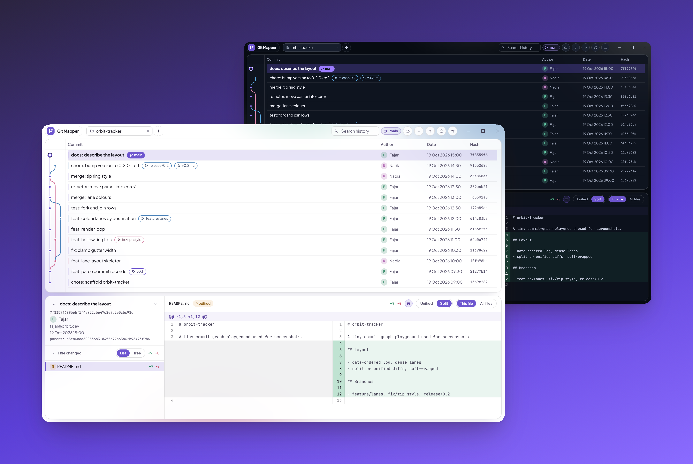
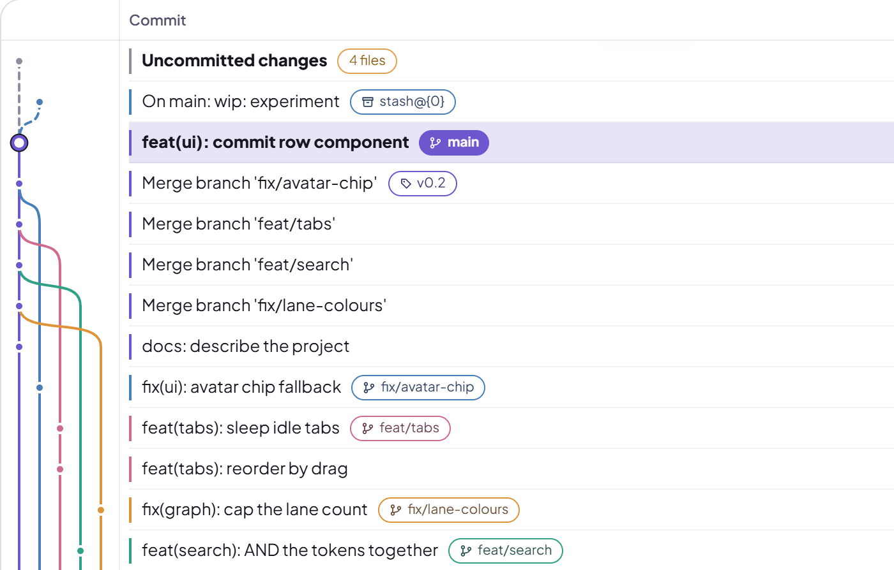
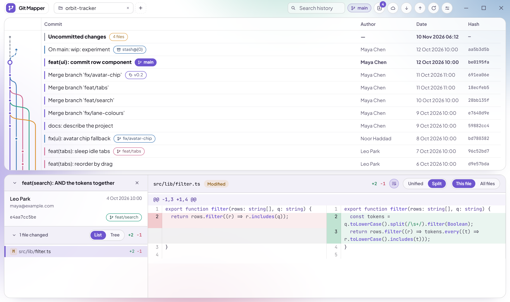
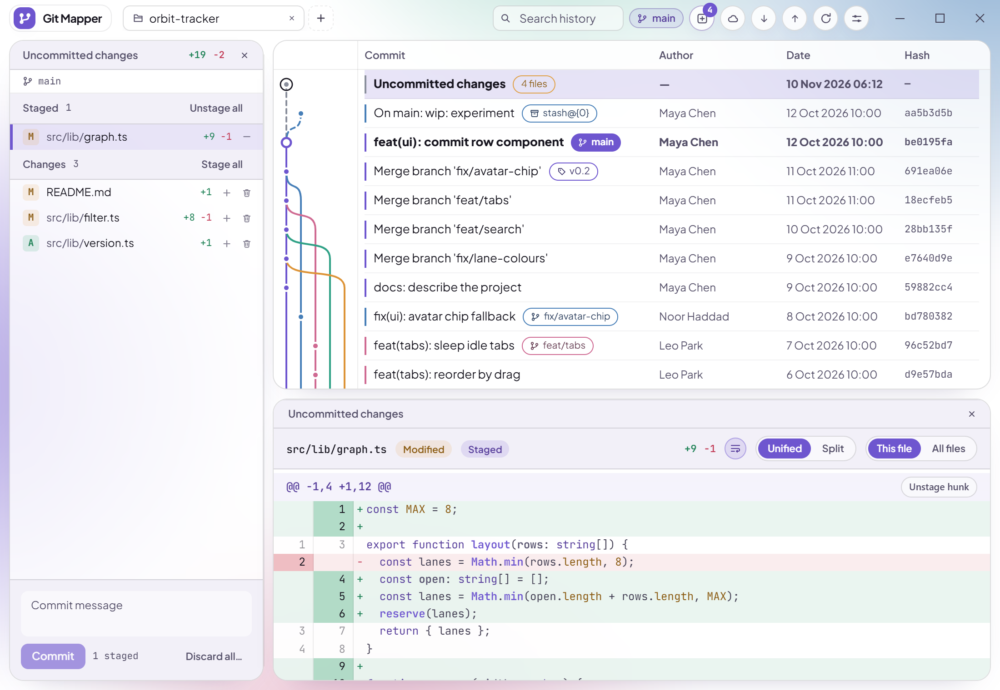
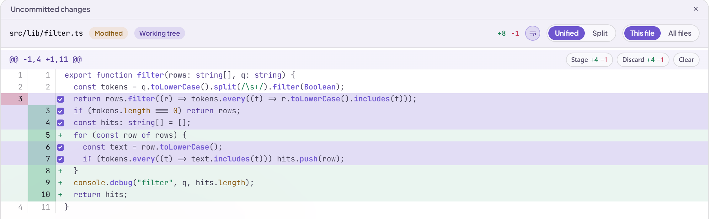
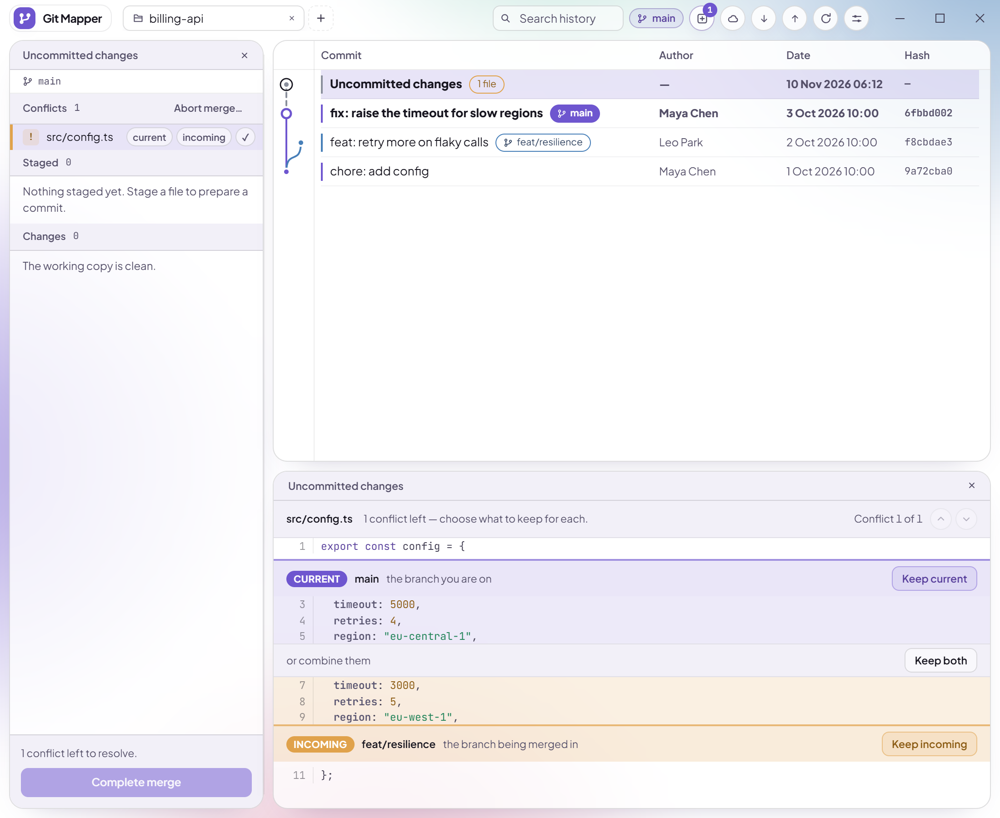

<div align="center">


# Git Mapper

**Every branch, crystal clear.**

A fast, lightweight Git history viewer for the desktop. Open a repository and follow the graph,
diffs and stashes on a clean pane — no account, no setup.

**[gitmapper.fajarwz.com](https://gitmapper.fajarwz.com)**

[](https://github.com/fajarwz/git-mapper/releases/latest)
[](https://github.com/fajarwz/git-mapper/releases)
[](https://github.com/sponsors/fajarwz)
[](LICENSE)

[](https://github.com/fajarwz/git-mapper/actions/workflows/ci.yml)
[](https://github.com/fajarwz/git-mapper/actions/workflows/release.yml)


</div>

## Download

Grab the latest installer from [the releases page](https://github.com/fajarwz/git-mapper/releases/latest):

| OS | Download |
| --- | --- |
| Windows | [`Git.Mapper_x64-setup.exe`](https://github.com/fajarwz/git-mapper/releases/latest/download/Git.Mapper_x64-setup.exe) (Unsigned installer. If SmartScreen appears, click More info, then Run anyway) |
| macOS | [`Git.Mapper.dmg`](https://github.com/fajarwz/git-mapper/releases/latest/download/Git.Mapper.dmg) (Apple Silicon + Intel. The app isn't notarized — right-click the app and pick **Open** to run it) |
| Linux | [`Git.Mapper_amd64.AppImage`](https://github.com/fajarwz/git-mapper/releases/latest/download/Git.Mapper_amd64.AppImage) (runs without installing) |

The links above always resolve to the newest release.



## Features

**Read history**



- **Lane-coloured graph.** Every branch keeps its colour from tip to root, forks and merges bend at
  their own commit, and branch, remote and tag pills sit on the rows. Resize the graph gutter,
  or drag it wider on lane-heavy histories.
- **Repository tabs.** Each tab remembers its selected commit, file and panel state; drag tabs
  into any order. Tabs you leave alone go to sleep to save memory and wake on click.
- **Search.** Filter the loaded history by hash, message, author or ref name. Ctrl+F focuses the
  title-bar box, Esc clears.
- **Your columns, your way.** Resize the commit / author / date columns, drag their headers to
  reorder them, right-click a header to hide one.
- **Stashes as rows.** Each stash sits above the commit it was taken on. Apply, pop or drop from
  its menu (pop and drop ask first).
- **Avatars.** Initials chips by default, Gravatar photos if you like (settings toggle).

**Read changes**



- **Diffs that read.** Line-numbered, syntax-highlighted (lazy per language, three colour
  schemes), with word-level change marks. Unified or split layout, soft-wrap or scroll.
- **One file or all of them.** Show the selected file alone, or stack every changed file in one
  scroll with sticky headers and a jump list.
- **Flat list or folder tree** for changed files, with status badges and rename hints.
- **Picture diffs** for images: 2-up, swipe or onion peel, with pixel sizes and byte counts.
- **Snappy.** Hover a file to prefetch its patch; clicking shows a skeleton while it loads.

**Change things**







- **Stage, commit, undo.** The `Uncommitted changes` row opens a staging rail: stage, unstage or
  discard by file, write the message and commit without leaving the window. Undo the tip commit
  and its files come back staged. The rail docks itself when the tree goes clean.
- **Hunks and single lines.** Stage, unstage or discard one hunk, or tick individual `+`/`-`
  lines and act on just those. Staged and unstaged sides are shown one at a time, like VS Code.
- **Sync.** Fetch, pull (fast-forward only) and push the checked-out branch from the counters
  beside its name.
- **Checkout.** Double-click a branch pill, or right-click for branch and commit checkout
  (detaching HEAD asks first).
- **Merge and resolve.** Merge a local branch from its pill's menu. Conflicts land in the rail:
  take current or incoming per file, or open the file with its conflict blocks inline and choose
  current, incoming or both per block. Finish with git's own message, or abort.
- **Copy** hashes and branch, remote, tag and stash names from the right-click menu.

**Stays out of your way**

- **Always current.** Refresh on window focus (only new commits get read), a periodic background
  fetch so ahead/behind counts are honest, or the toolbar button. Rows a refresh touched flash.
- **Light and dark glass themes**, zoom the whole window with Ctrl/Cmd plus, minus and zero, and
  window size and position restored on launch.
- **Updates itself.** Checks on launch, downloads in the background, restarts when you say so.
- **Local and private.** No account, no telemetry in the app; it runs your own `git`.

## Run it

```bash
npm install
npm run dev        # browser at http://localhost:1420
npm run tauri dev  # desktop window (compiles the Rust side)
```

```bash
npm run build      # tsc && vite build
npm run lint       # Tailwind class hygiene
npm run tauri build
```

Git has to be on `PATH`.

## How it works

The Rust side (`src-tauri/src/git.rs`) runs `git` and returns its porcelain output; the parsers in
`src/lib/` turn that text into the types in `src/types.ts`. Every backend call goes through
`src/data/gitLoader.ts`, so components never invoke the backend themselves. `npm run dev` serves
the same commands at `POST /api/git`, which is why the app also runs in a plain browser.

## Not there yet

- Searching history beyond the loaded 500-commit window.
- Rebasing and cherry-picking.
- Pull requests (a `gh` passthrough is the planned next slice).

## Support

Git Mapper is free and GPL, and it stays free. If it saves you time, you can
[sponsor the project on GitHub](https://github.com/sponsors/fajarwz). Nothing in the app is locked
behind it, and the best thing you can give me instead is a good bug report.

Contributions are welcome, and [CONTRIBUTING.md](CONTRIBUTING.md) says how: I read every issue and
pull request myself.

## License

[GNU General Public License v3.0 or later](LICENSE). Copyright © 2026 Fajar Windhu Zulfikar.
