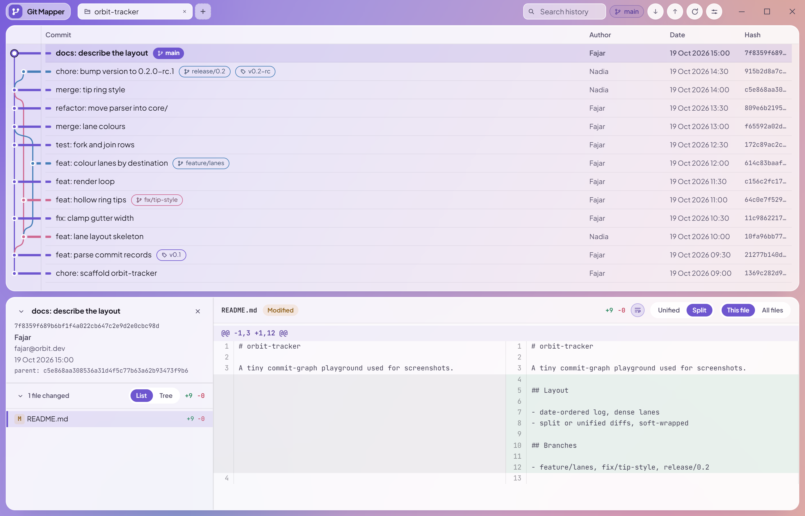
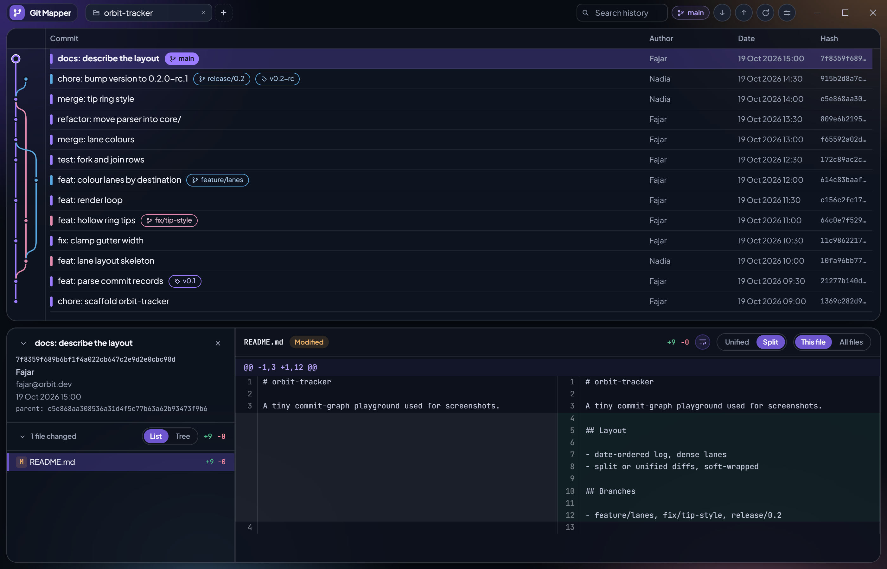
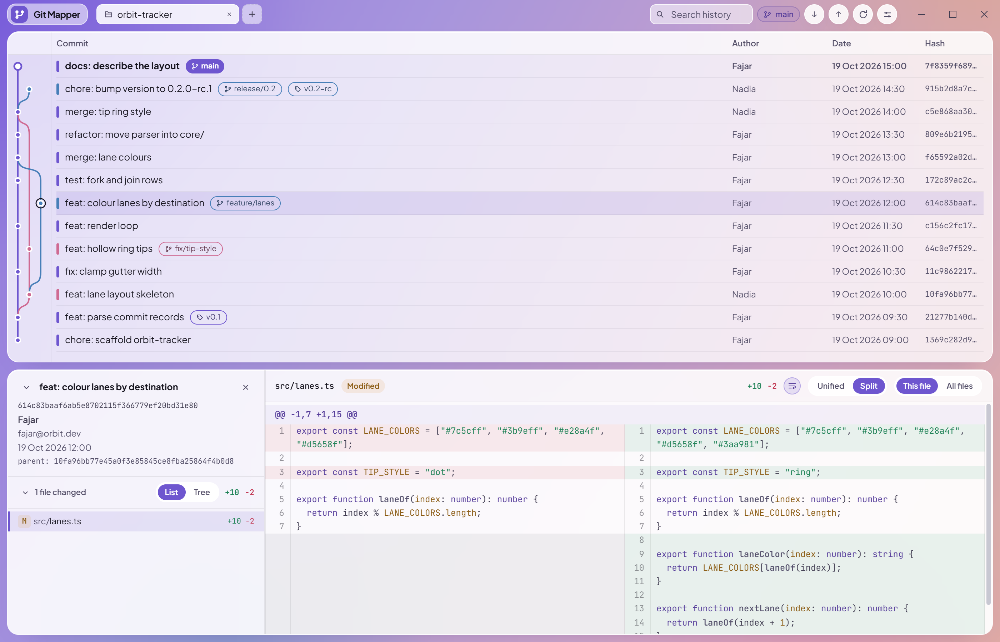
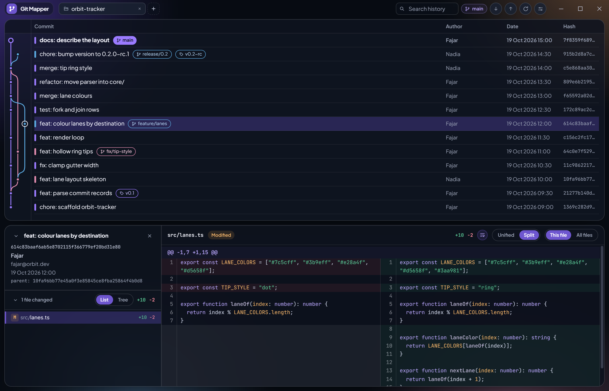

<div align="center">


# Git Mapper

[](https://github.com/fajarwz/git-mapper/releases/latest)
[](https://github.com/fajarwz/git-mapper/releases)
[](https://github.com/fajarwz/git-mapper/actions/workflows/release.yml)


A standalone Git history viewer for the desktop. Tauri 2, React 19, TypeScript and Tailwind CSS v4,
reading real repositories through the `git` CLI.

</div>

## Download

Grab the latest installer from [the releases page](https://github.com/fajarwz/git-mapper/releases/latest):

| OS | Download |
| --- | --- |
| Windows | [`Git.Mapper_x64-setup.exe`](https://github.com/fajarwz/git-mapper/releases/latest/download/Git.Mapper_x64-setup.exe) |
| macOS (Apple Silicon) | [`Git.Mapper_aarch64.dmg`](https://github.com/fajarwz/git-mapper/releases/latest/download/Git.Mapper_aarch64.dmg) |
| macOS (Intel) | [`Git.Mapper_x64.dmg`](https://github.com/fajarwz/git-mapper/releases/latest/download/Git.Mapper_x64.dmg) |
| Linux | [`Git.Mapper_amd64.AppImage`](https://github.com/fajarwz/git-mapper/releases/latest/download/Git.Mapper_amd64.AppImage) (runs without installing) |

The links above always resolve to the newest release. On macOS, the first launch gets a Gatekeeper
warning because the app isn't notarized — right-click the app and pick **Open** to run it.





## What it does

- Opens repositories as tabs. Each tab remembers its selected commit, file and panel state, and
  tabs can be dragged into any order.
- Commit list with a graph whose lines keep their colour from tip to root, and branch,
  remote and tag pills. Double-click a branch
  pill to check it out.
- Details panel with commit metadata and the changed-file list — flat or folder tree, with status
  badges — and a line-numbered diff with lazy syntax highlighting. Image files get a picture diff
  (2-up, swipe, onion peel) instead of a text diff.
- Diff layout: unified or split (old lines left, new lines right, like GitHub). The empty side of
  an added or deleted line carries a tinted void so it reads as coming from nothing, and long
  lines soft-wrap by default with a toggle to scroll instead.
- An `Uncommitted changes` row on top while the working tree is dirty: staged, unstaged and
  untracked files, diffed against `HEAD`.
- Refresh on window focus (only the commits that are new get read) or from the toolbar button.
  Rows a refresh touched flash amber.
- Light and dark glass themes, remembered across restarts together with the window size and
  position.
- Resizable graph gutter, commit / author / date columns and details panel height.
- Search over the loaded history: hashes, commit messages, authors and ref pills. Ctrl+F focuses
  the title-bar box, Esc clears.

Ships for Windows, macOS and Linux; the macOS builds are signed with the updater's minisign key but
not notarized, so Gatekeeper warns on first launch (right-click → Open to get past it).

## Run it

```bash
npm install
npm run dev        # browser at http://localhost:1420
npm run tauri dev  # desktop window (compiles the Rust side)
```

```bash
npm run build      # tsc && vite build
npm run lint       # Tailwind class hygiene
npm run tauri build
```

Git has to be on `PATH`.

## How it works

The Rust side (`src-tauri/src/git.rs`) runs `git` and returns its porcelain output; the parsers in
`src/lib/` turn that text into the types in `src/types.ts`. Every backend call goes through
`src/data/gitLoader.ts`, so components never invoke the backend themselves. `npm run dev` serves
the same commands at `POST /api/git`, which is why the app also runs in a plain browser.

The only thing the app changes in a repository is a branch checkout.

## Not there yet

- Searching history beyond the loaded 500-commit window.
- Staging, committing, merging, rebasing.
