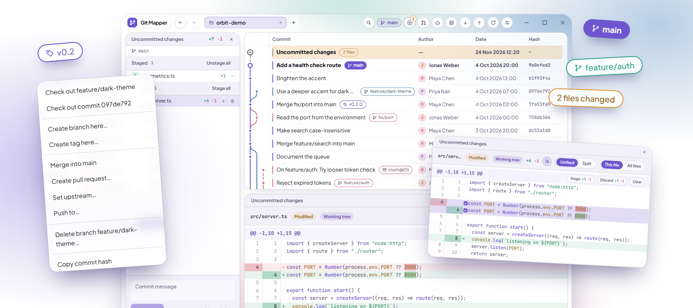
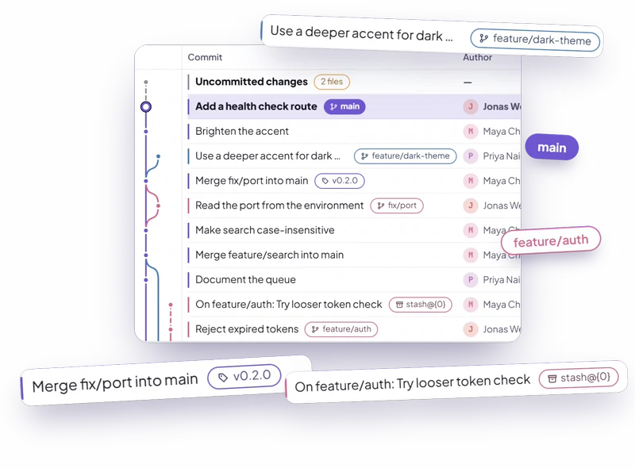
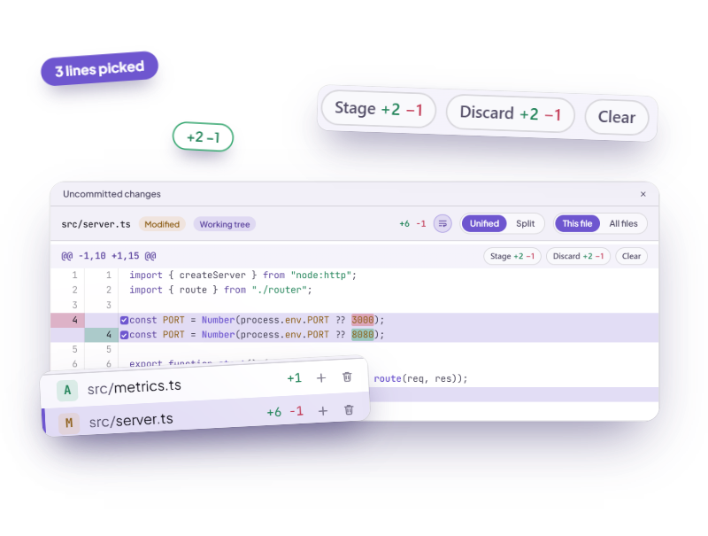
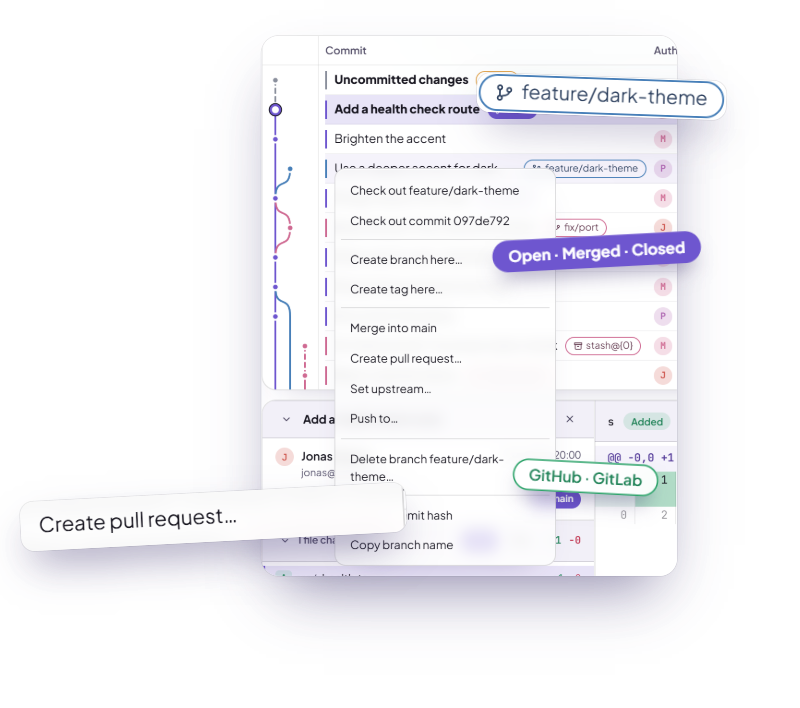
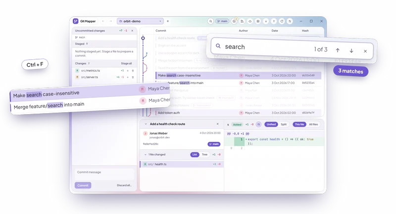
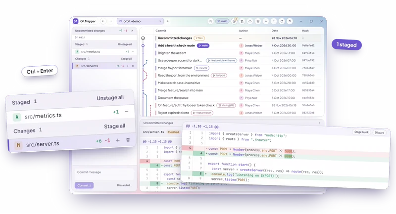
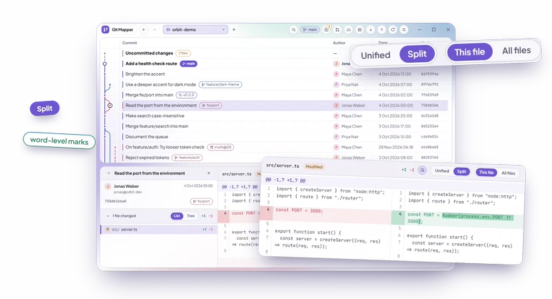

<div align="center">


# Git Mapper

**Git, easy as a click.**

A fast, lightweight Git visualizer for the desktop. Read your history as a graph, then stage,
commit and merge with a click. No account, no setup.

**[gitmapper.fajarwz.com](https://gitmapper.fajarwz.com)**

[](https://github.com/fajarwz/git-mapper/releases/latest)
[](https://github.com/fajarwz/git-mapper/releases)
[](https://github.com/sponsors/fajarwz)
[](LICENSE)

[](https://github.com/fajarwz/git-mapper/actions/workflows/ci.yml)
[](https://github.com/fajarwz/git-mapper/actions/workflows/release.yml)




</div>

## Download

Grab the latest installer from [the releases page](https://github.com/fajarwz/git-mapper/releases/latest):

| OS | Download |
| --- | --- |
| Windows | [`Git.Mapper_x64-setup.exe`](https://github.com/fajarwz/git-mapper/releases/latest/download/Git.Mapper_x64-setup.exe) (Unsigned installer. If SmartScreen appears, click More info, then Run anyway) |
| macOS | [`Git.Mapper.dmg`](https://github.com/fajarwz/git-mapper/releases/latest/download/Git.Mapper.dmg) (Apple Silicon + Intel. The app isn't notarized — right-click the app and pick **Open** to run it) |
| Linux | [`Git.Mapper_amd64.AppImage`](https://github.com/fajarwz/git-mapper/releases/latest/download/Git.Mapper_amd64.AppImage) (runs without installing) |

The links above always resolve to the newest release.

## Features

<table>
<tr>
<td width="45%" valign="middle">
<h3>The graph, in lane colours</h3>
<p>Every branch owns a hue from tip to root. Forks bend exactly at their commit, merges join back cleanly, and dense lanes stay readable hundreds of rows in.</p>
<ul>
<li>Branch, remote and tag pills on every row; double-click to check out</li>
<li>Stashes sit as rows above the commit they were taken on</li>
<li>Reorder, resize and hide columns to suit you</li>
<li>Each repository in its own tab, restored on launch</li>
</ul>
</td>
<td width="55%" valign="middle">

</td>
</tr>
</table>

<table>
<tr>
<td width="55%" valign="middle">

</td>
<td width="45%" valign="middle">
<h3>Down to the single line</h3>
<p>Stage or discard one hunk, or tick just the lines you mean. Commit half of a messy file as two clean commits, no command line needed.</p>
<ul>
<li>Tick the gutter, or drag across several lines</li>
<li>The hunk’s buttons become Stage, Unstage or Discard N lines</li>
<li>Staged and unstaged sides shown one at a time, like VS Code</li>
<li>A hunk that moved underneath you is refused, never misapplied</li>
</ul>
</td>
</tr>
</table>

<table>
<tr>
<td width="45%" valign="middle">
<h3>Pull requests, one click away</h3>
<p>Branch pills carry a badge for their GitHub pull request or GitLab merge request, and a list in the title bar shows the open and merged ones. Ready to open one? It is in the branch’s right-click menu.</p>
<ul>
<li>Open, merged and closed states, with a searchable list</li>
<li>Create pull request… opens the new-PR page for that branch in your browser</li>
<li>Works with GitHub and GitLab remotes</li>
<li>Read-only: Git Mapper never changes your pull requests</li>
</ul>
</td>
<td width="55%" valign="middle">

</td>
</tr>
</table>

<table>
<tr>
<td width="55%" valign="middle">

</td>
<td width="45%" valign="middle">
<h3>Find it, jump to it</h3>
<p>Search the history without leaving it, hop between repositories by name, and step back through what you were just looking at. All of it from the keyboard.</p>
<ul>
<li>Ctrl+F opens a floating find bar: match by hash, message, author or ref, the rest fade, Enter steps through the hits</li>
<li>Ctrl+P jumps to any open repository by name, path or number</li>
<li>Alt+Left and Alt+Right step back and forward through your selections</li>
<li>Ctrl+T, Ctrl+W, Ctrl+1–9 and Ctrl+Tab drive the tabs; every shortcut is listed in Settings</li>
</ul>
</td>
</tr>
</table>

<table>
<tr>
<td width="45%" valign="middle">
<h3>Stage, commit, undo</h3>
<p>The uncommitted row opens a staging rail beside the diff. Stage, unstage or discard by file, write the message and commit. Changed your mind? Undo the tip commit and its files come back staged.</p>
<ul>
<li>Stage, unstage or discard a whole hunk in one click</li>
<li>Fetch, pull (fast-forward only) and push from the branch counters</li>
<li>Ctrl+Enter commits from the message box; destructive actions sit behind a clear confirm</li>
<li>The rail docks itself once the working tree is clean</li>
</ul>
</td>
<td width="55%" valign="middle">

</td>
</tr>
</table>

<table>
<tr>
<td width="55%" valign="middle">

</td>
<td width="45%" valign="middle">
<h3>Merge, and settle conflicts in place</h3>
<p>Merge a local branch from its pill. If git stops on conflicts they land in the rail: take a side per file, or open the file and pick current, incoming or both for each block.</p>
<ul>
<li>Conflict blocks inline, with line numbers and syntax colours</li>
<li>Keep current, keep incoming, or keep both, block by block</li>
<li>Finish with git’s own prepared message</li>
<li>Or abort and the repository returns to how it was</li>
</ul>
</td>
</tr>
</table>

<table>
<tr>
<td width="45%" valign="middle">
<h3>Diffs that read</h3>
<p>Unified or split like GitHub, syntax highlighted in three colour schemes, with word-level marks showing exactly what changed.</p>
<ul>
<li>One file at a time, or every changed file stacked in one scroll</li>
<li>Flat list or folder tree, with status badges and renames</li>
<li>Picture diffs for images: 2-up, swipe or onion peel</li>
<li>Hover a file and its patch is already loading</li>
</ul>
</td>
<td width="55%" valign="middle">

</td>
</tr>
</table>

### Also in the box

- **Stashes as rows.** Each stash sits above the commit it was taken on. Apply, pop or drop from its menu (pop and drop ask first).
- **Always current.** Refresh on window focus (only new commits get read), a periodic background fetch so ahead/behind counts are honest, or the toolbar button.
- **Tabs that remember.** Selected commit, file and panel state per repository; drag to reorder, idle tabs sleep to save memory.
- **Checkout, copy and right-click menus.** Double-click a branch pill to check out; copy hashes and branch, remote, tag and stash names from the menu.
- **Faces or initials.** Author avatars are initials chips by default; turn on Gravatar photos in settings.
- **Light and dark glass themes**, whole-window zoom with Ctrl/Cmd plus, minus and zero, and window size and position restored on launch.
- **Updates itself.** Checks on launch, downloads in the background, restarts when you say so.
- **Local and private.** No account, no telemetry in the app; it runs your own `git`.

## Run it

```bash
npm install
npm run dev        # browser at http://localhost:1420
npm run tauri dev  # desktop window (compiles the Rust side)
```

```bash
npm run build      # tsc && vite build
npm run lint       # Tailwind class hygiene
npm run tauri build
```

Git has to be on `PATH`.

## How it works

The Rust side (`src-tauri/src/git.rs`) runs `git` and returns its porcelain output; the
parsers in each `src/features/*/lib/` folder turn that text into the types in `src/types.ts`. Every backend call goes through
`src/data/gitLoader.ts`, so components never invoke the backend themselves. `npm run dev` serves
the same commands at `POST /api/git`, which is why the app also runs in a plain browser.

## Support

Git Mapper is free and GPL, and it stays free. If it saves you time, you can
[sponsor the project on GitHub](https://github.com/sponsors/fajarwz). Nothing in the app is locked
behind it, and the best thing you can give me instead is a good bug report.

Contributions are welcome, and [CONTRIBUTING.md](CONTRIBUTING.md) says how: I read every issue and
pull request myself.

## License

[GNU General Public License v3.0 or later](LICENSE). Copyright © 2026 Fajar Windhu Zulfikar.
